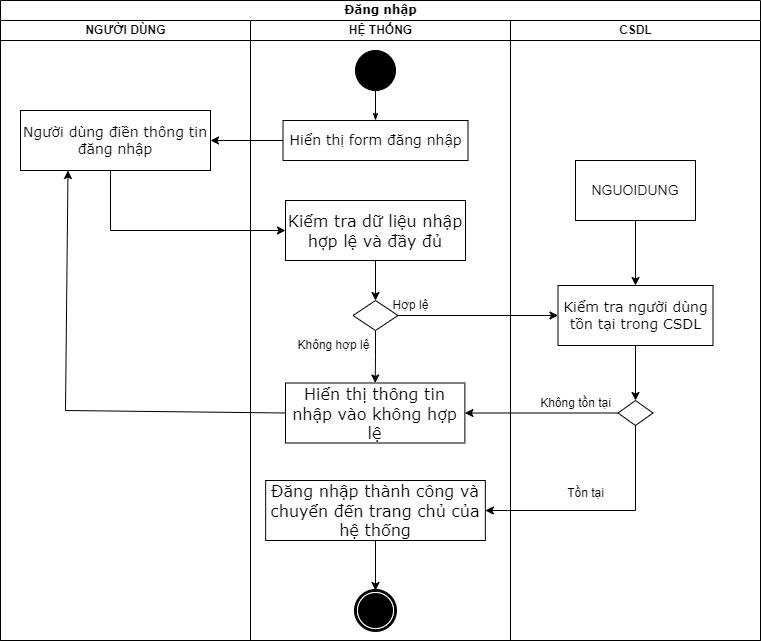
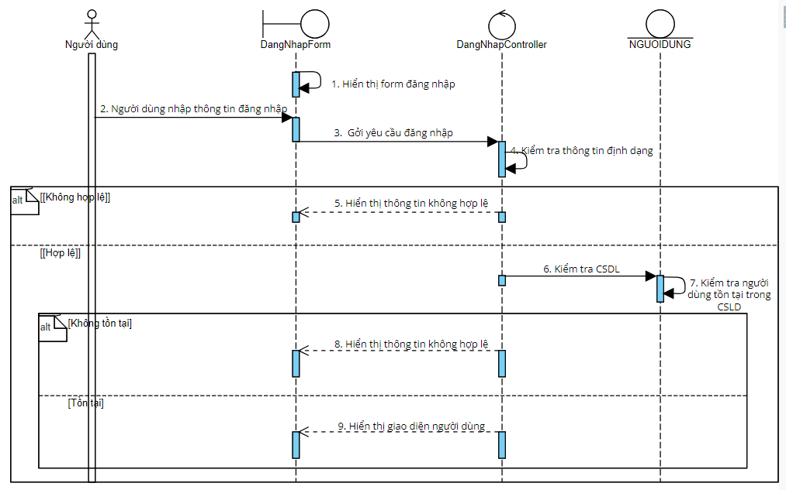

# UC01 - Login

**Description:** Allows manager/employee to log in.

**Primary actors:** Manager, Employee  
**Precondition:** User account has already been registered.  
**Postcondition:** User successfully enters the system.  
**Importance:** Medium.

## Main flow

1. User requests login.
2. User enters login information.
3. System validates the login information.
4. System displays successful login and navigates to the home screen.

## Alternative flow

- If login information is incorrect, the use case returns to the data-entry step.

## Activity diagram

## Sequence diagram

