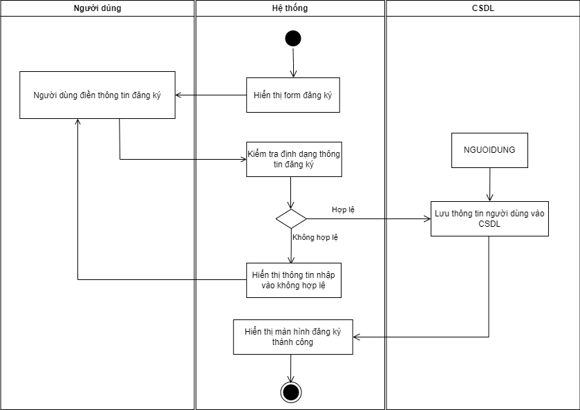
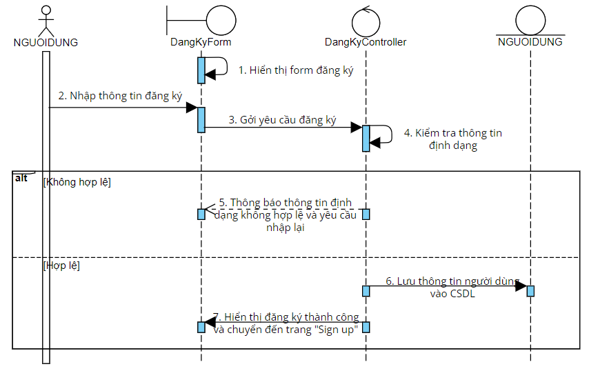

# UC02 - Register

**Description:** Allows manager/employee to register an account.  
**Primary actors:** Manager, Employee  
**Precondition:** User wants access to the system.  
**Postcondition:** A new account is stored in the database.  
**Importance:** Medium.

## Main flow

1. System displays the registration form.
2. User enters name, email, password, phone number and selects Sign Up.
3. System validates input format.
4. System displays successful registration/login-related success state as documented.
5. User information is stored in the database.

## Alternative flow

- If input format is invalid, the system displays an error and returns to input validation/data entry.

