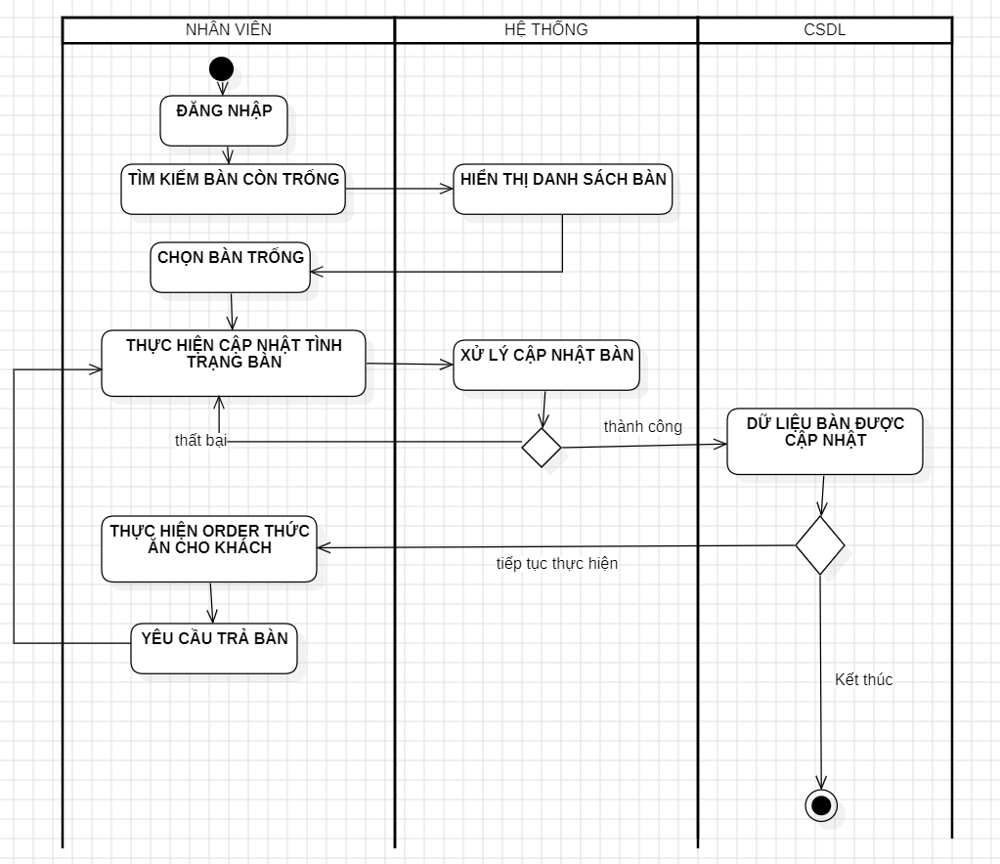
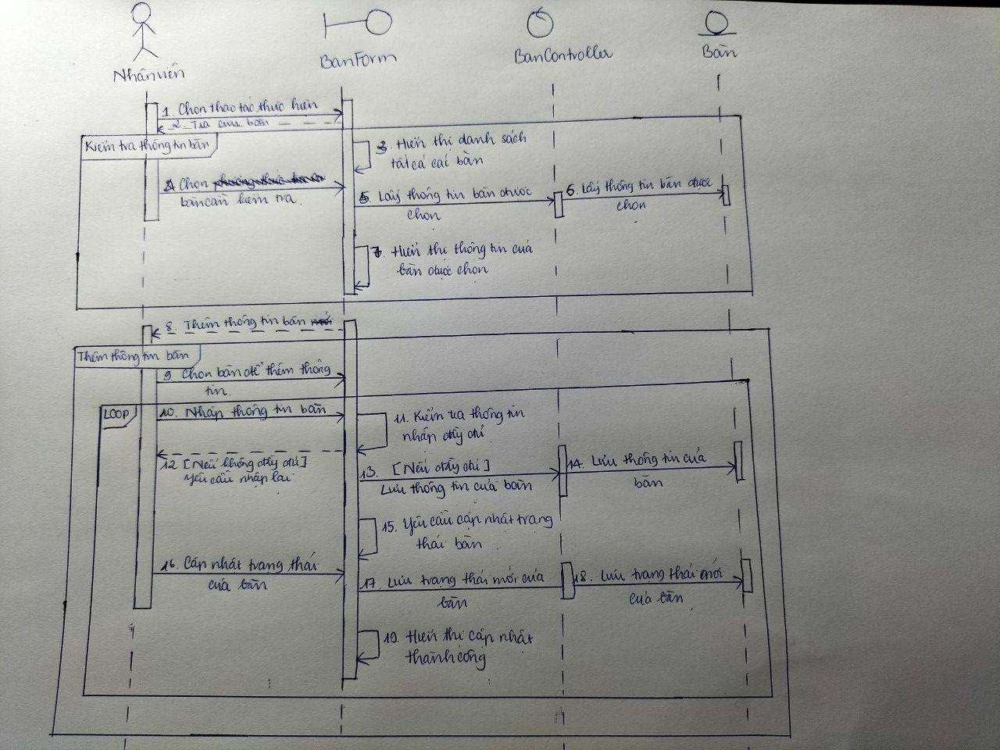

# UC03 - Table Management

**Description:** Allows staff to check whether tables are in use, update table status, and continue to ordering for a seated table.  
**Primary actor:** Employee  
**Precondition:** User has logged in.  
**Postcondition:** Table assignment is confirmed and table status is updated.  
**Importance:** High.

## Main flow

1. Customer arrives at the restaurant.
2. Staff determines party size and searches for a suitable empty table.
3. Staff assigns/selects the table and updates its status.

## Alternative / exception flow

- If customers are seated but table state has not been updated, staff must update the table state in the system.

