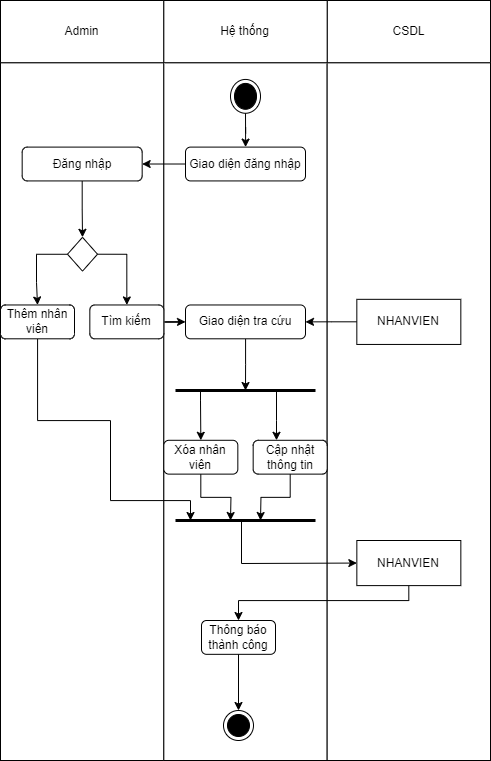
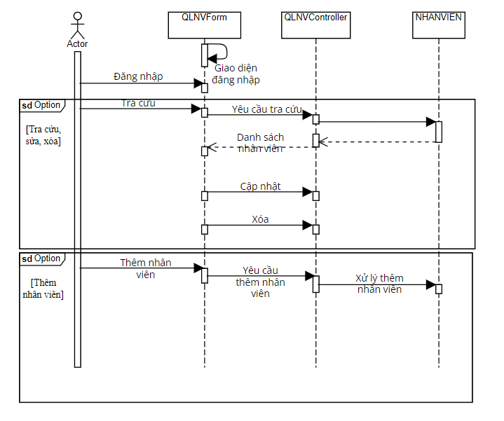

# UC04 - Employee Management

**Description:** Allows management to update/change employee information.  
**Primary actor:** Manager  
**Precondition:** Manager has logged in.  
**Postcondition:** Employee list/information is added, deleted, updated, or searched.  
**Importance:** High.

## Main flow

1. System displays employee-management screen.
2. Manager enters/selects employee information and performs add/delete/update as needed.

## Alternative flow

- If information is incomplete, the system requires the information to be entered again.

