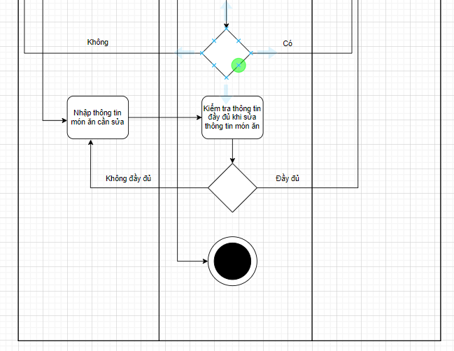
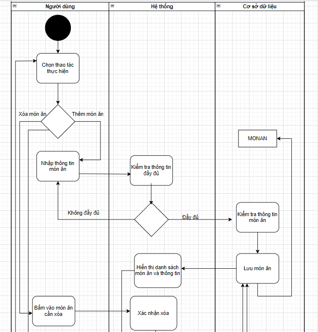
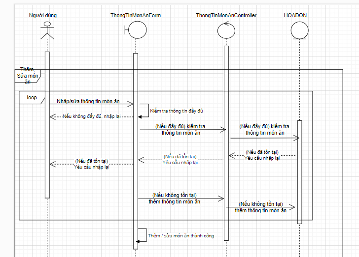
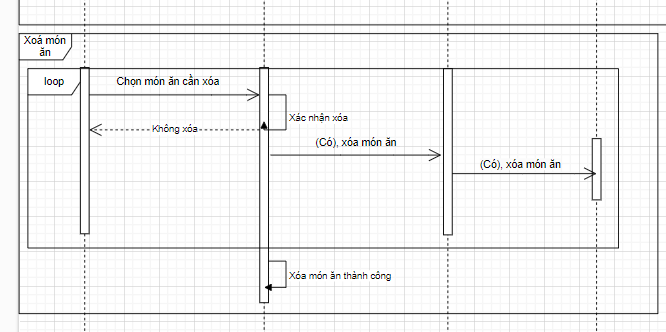

# UC05 - Food/Menu Management

**Description:** Allows management to update/change food information in the menu.  
**Primary actor:** Manager  
**Precondition:** Manager has logged in.  
**Postcondition:** Food information is added, deleted, updated, or searched.  
**Importance:** High.

## Main flow

1. System displays food-management screen.
2. Manager enters/selects food information and performs add/delete/update.

## Alternative flow

- If required input is incomplete, the system requires re-entry.

