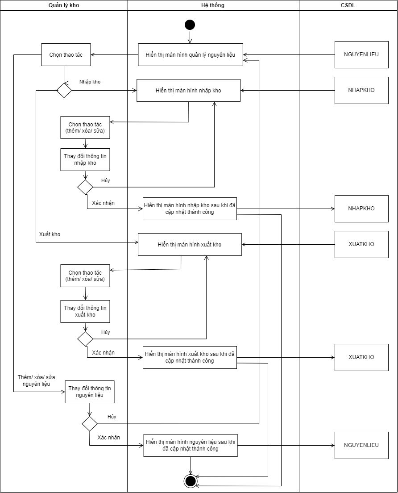
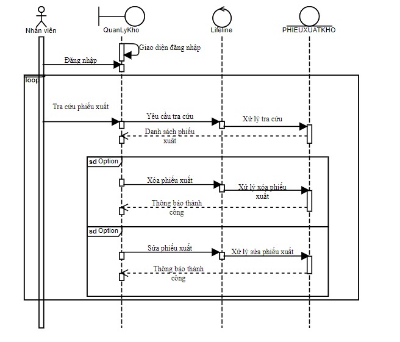
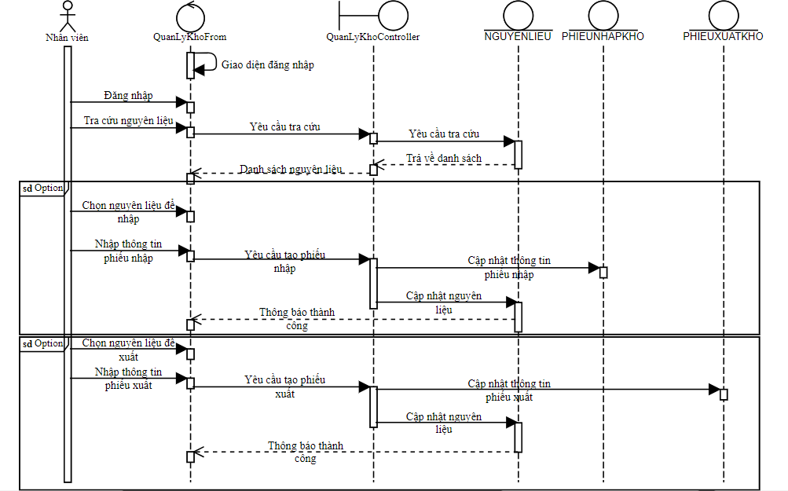

# UC06 - Inventory Management

**Description:** Allows users to update and change ingredient information and manage inbound/outbound stock records.  
**Precondition:** User has logged in.  
**Postcondition:** Ingredient / inbound / outbound information is updated in the database.  
**Importance:** High.

## Main flow

1. System displays the ingredient/inventory screen.
2. User chooses Add/Delete/Update Ingredient, Inbound, or Outbound.
3. System displays the selected function screen.
4. User updates ingredient/inbound/outbound information.
5. System validates the information.
6. System displays the updated ingredient/inbound/outbound view.
7. System saves new information to the database.

## Alternative flow

- If validation fails, the system displays an error and returns to the related operation screen.

