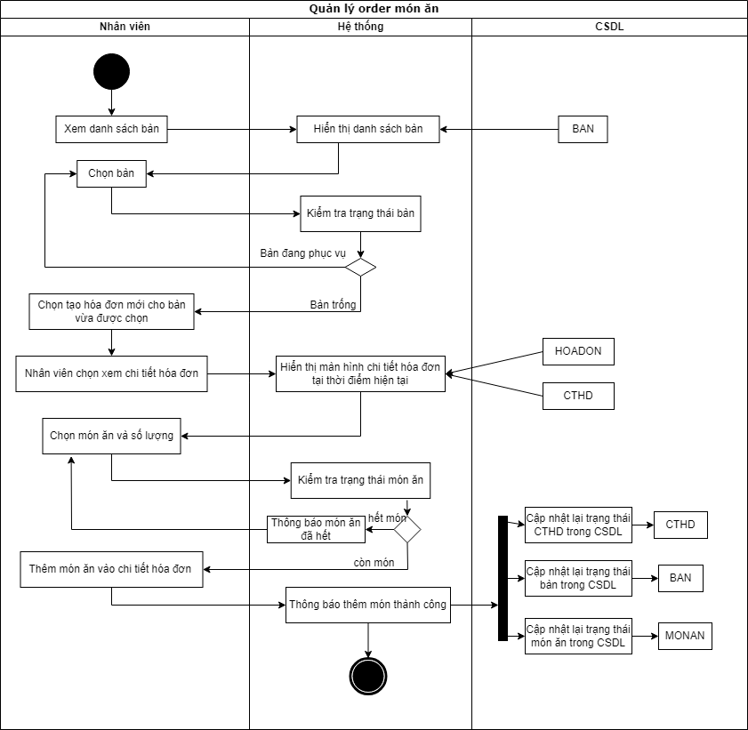
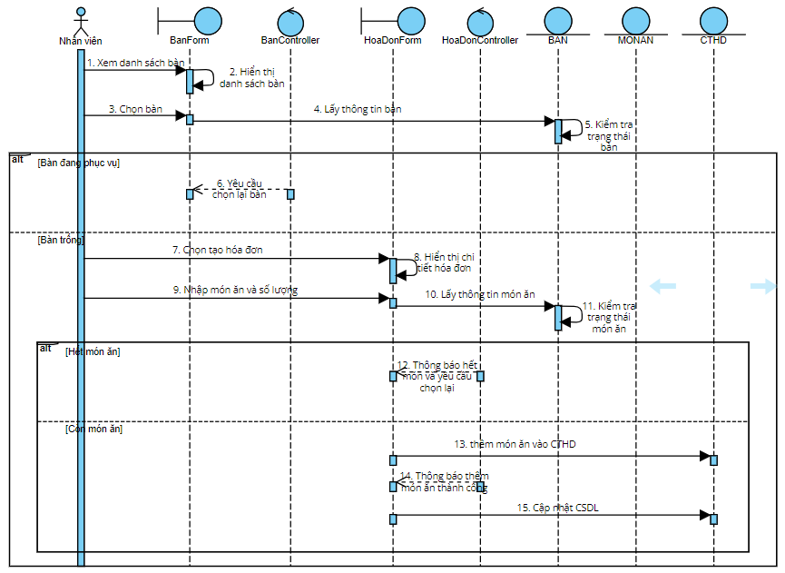

# UC07 - Food Ordering

**Description:** Allows staff to select food and a table according to customer needs and create the related invoice/order details.  
**Primary actor:** Employee  
**Preconditions:** Employee is logged in; employee has checked table availability and selected an empty table.  
**Postcondition:** Ordered food is stored in invoice detail.  
**Importance:** High.

## Main flow

1. Table-management screen is displayed.
2. Staff selects an empty table and creates a new invoice/order context.
3. Invoice-detail screen is displayed.
4. Staff adds food items and quantities for the selected table.
5. System checks food status/availability.
6. System confirms successful food addition.
7. Food item is stored in invoice detail in the database.

## Alternative flows

- If the table is already in use, the system requires another table selection.
- If a food item is unavailable, the system displays an out-of-stock message and requires another selection.

