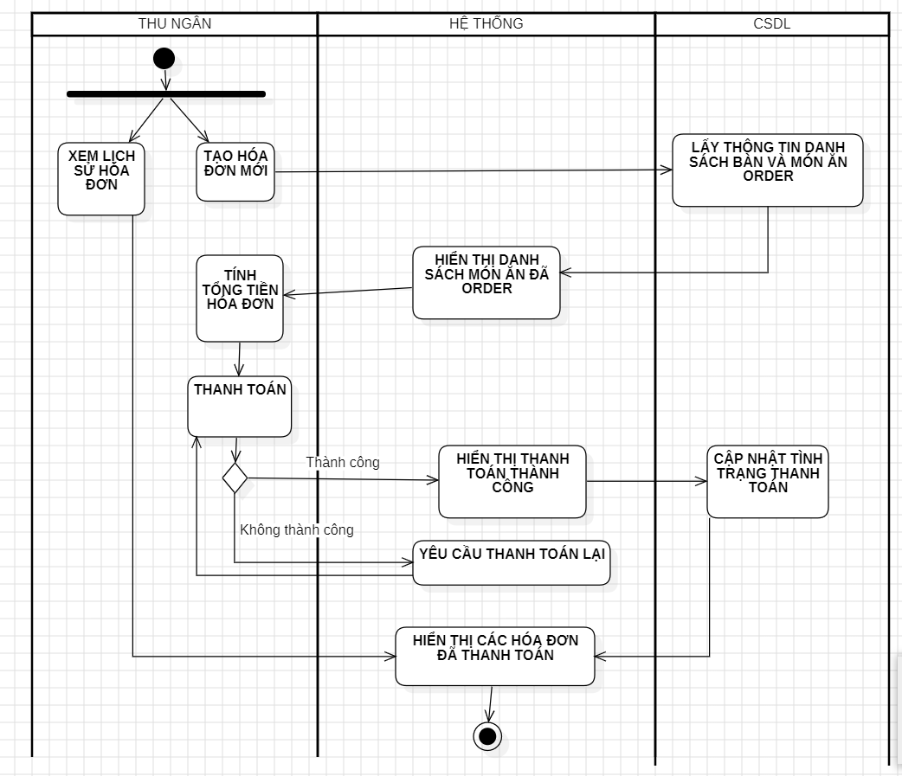
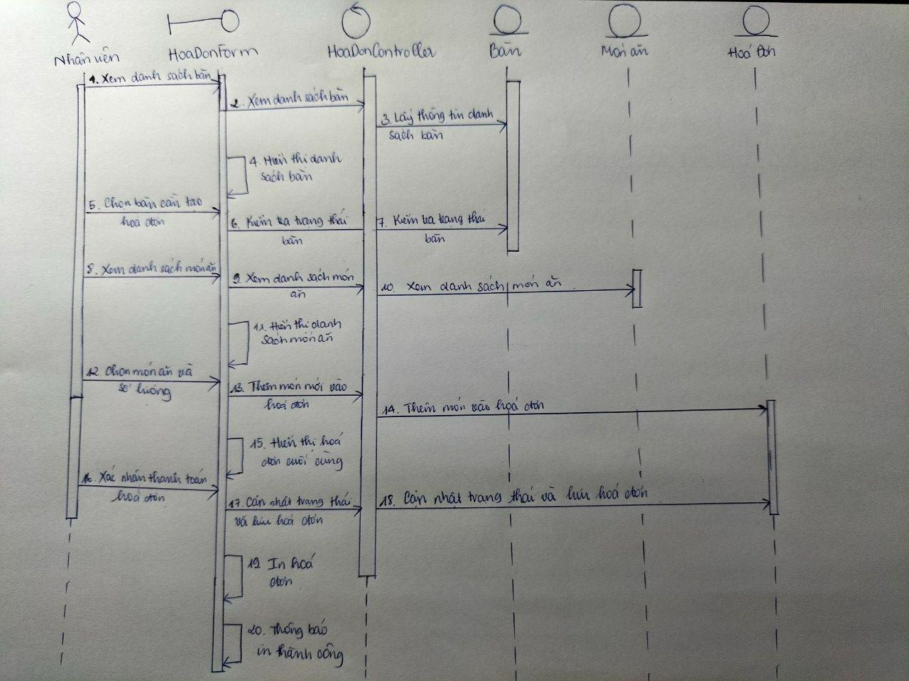

# UC08 - Invoice Management

**Description:** Allows cashier to create invoices, update invoice status, process payment, and review invoice history.  
**Primary actor:** Cashier  
**Precondition:** User is logged in.  
**Trigger:** Customer has ordered food.  
**Postcondition:** Payment is confirmed; invoice/payment details are stored and an invoice can be provided in paper/electronic form.  
**Importance:** High.

## Main flow

1. Customer requests payment.
2. Cashier identifies the order and creates the invoice.
3. Cashier performs payment steps.
4. Cashier/system updates invoice status.
5. System stores invoice and payment details.

## Subflow - Create invoice

1. Cashier selects ordered food items.
2. System displays order information: table, food name, quantity, unit price, total.

## Subflow - Payment

1. Cashier chooses payment.
2. System or cashier updates payment status.

## Exceptions

- Invalid order code: system displays an error and requires re-entry/confirmation.
- Unsupported/invalid payment method: customer is asked to select a valid method.

