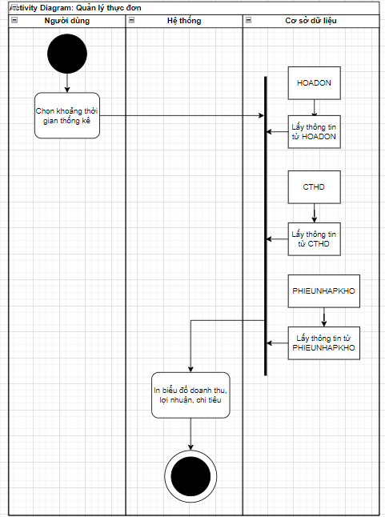
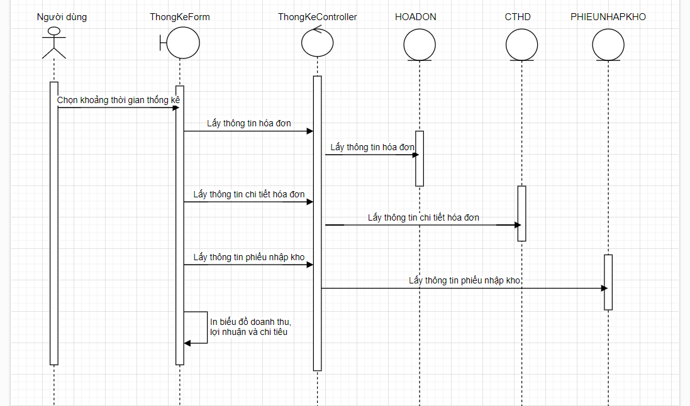

# UC09 - Financial Statistics

**Description:** Allows management to review revenue and the most frequently ordered food as documented.  
**Primary actor:** Admin / Manager  
**Precondition:** Admin is logged in to statistics management.  
**Postcondition:** Requested statistics are returned.  
**Trigger:** Admin selects statistics management.

## Main flow

1. Admin requests the statistics function.
2. Admin chooses a time interval: day, month, or year.
3. System returns the statistics result.

