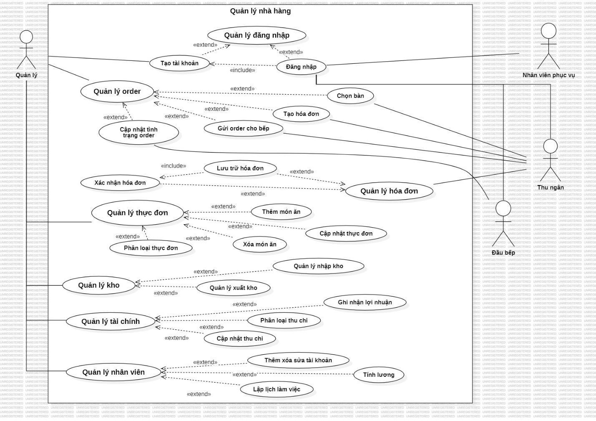

# Use Case Catalog

| ID | Use Case | Meaning |
|---|---|---|
| UC01 | Login | Actor logs in to the system |
| UC02 | Register | Actor registers an account |
| UC03 | Table Management | Manage/check table information and status |
| UC04 | Employee Management | Maintain/search employee information |
| UC05 | Food/Menu Management | Maintain/search food information |
| UC06 | Inventory Management | Manage ingredients and inbound/outbound stock |
| UC07 | Food Ordering | Staff selects table/food and creates order/invoice detail |
| UC08 | Invoice Management | Create/update/pay/search invoice information |
| UC09 | Financial Statistics | Review financial information through invoices/inbound records |

